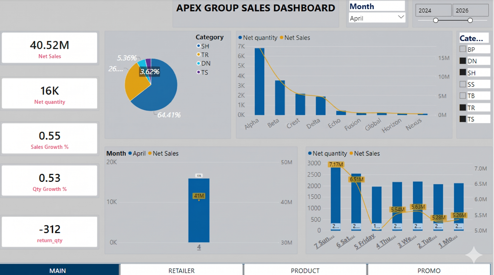
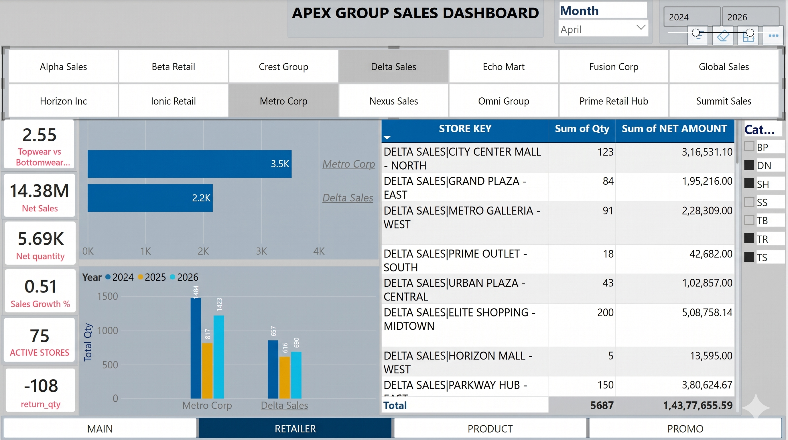
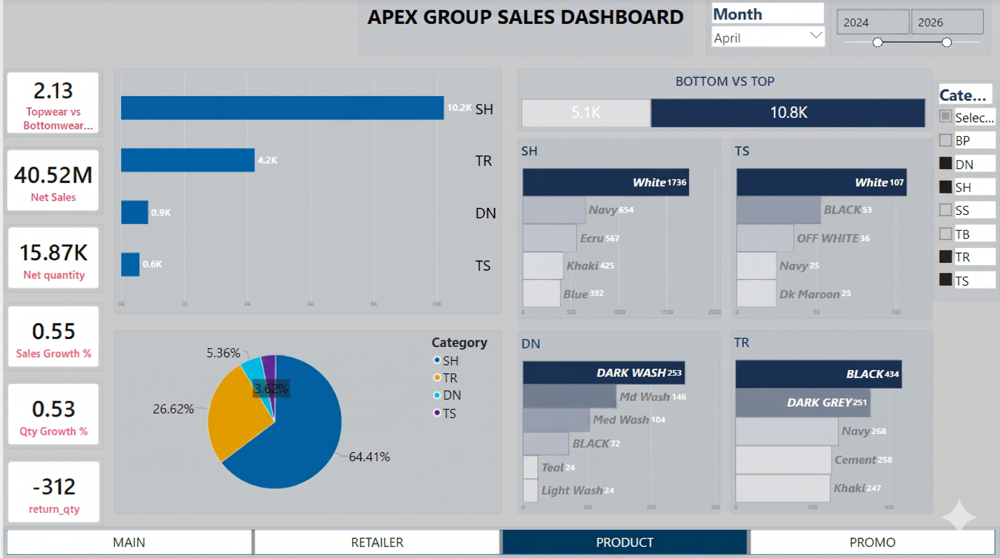

# Apparel Retail Sales Dashboard (Power BI)

> [!CAUTION]
> **CONFIDENTIALITY & AI DATA MORPHING NOTICE:** All brand names, retailer names, store keys, and business identifiers shown in these screenshots have been **modified and anonymized using AI** to protect client confidentiality. The dashboard architecture, DAX logic, and interactive reporting capabilities reflect the original production solution.

A multi-page **Power BI** analytics suite designed for apparel retail leadership, merchandising, and account management teams—featuring dedicated views for **Executive Overview**, **Retailer Performance**, **Product & Color Mix**, and **Promotions**.

---

## 1. Main Executive Overview

* **Headline KPIs:** Tracks **Net Sales (40.52M)**, **Net Quantity (16K)**, **Sales Growth % (0.55)**, **Qty Growth % (0.53)**, and **Return Quantity (-312)** in a clean left-hand rail.
* **Category Mix:** Pie chart breaking down sales contribution across core apparel categories (`SH` 64.41%, `TR` 26.62%, `DN` 5.36%, `TS` 3.62%).
* **Retailer Ranking:** Dual-axis combo chart comparing **Net Quantity** and **Net Sales** across top retail partners.
* **Day-of-Week Performance:** Identifies peak shopping days (e.g., Sunday at 7.17M and Saturday at 6.51M) to support staffing and inventory replenishment.

---

## 2. Retailer & Store-Level Performance

* **Interactive Retailer Slicer Grid:** One-click button matrix to isolate individual or multiple retail accounts alongside **Active Stores (75)** and **Topwear vs. Bottomwear Ratio (2.55)**.
* **Multi-Year Volume Comparison:** Clustered column chart tracking **Total Qty** across **2024, 2025, and 2026** by selected retail partners.
* **Store-Key Granularity:** Detailed store-level table breaking down `Sum of Qty` and `Sum of NET AMOUNT` with automated grand totals.

---

## 3. Product & Color Mix Analysis

* **Topwear vs. Bottomwear Split:** Visual ratio bar comparing **Topwear (10.8K)** against **Bottomwear (5.1K)** with a **2.13** overall ratio KPI.
* **Category Volume Breakdown:** Horizontal bar chart ranking unit volume across `SH` (10.2K), `TR` (4.2K), `DN` (0.9K), and `TS` (0.6K).
* **Top-Selling Colors by Category:** Dedicated horizontal bar visuals highlighting leading colorways for each category (`White`, `Navy`, `Ecru`, `Dark Wash`, `Black`, `Dark Grey`, etc.) to guide seasonal buying and restocking.

---

## Tech Stack
* **BI Platform:** Microsoft Power BI
* **Navigation & UX:** Multi-page tab navigation (`MAIN`, `RETAILER`, `PRODUCT`, `PROMO`), dynamic month/year sliders, and category filters
* **Modeling & DAX:** Star-schema data model with custom DAX measures for YoY growth, return tracking, and Topwear-to-Bottomwear ratios
